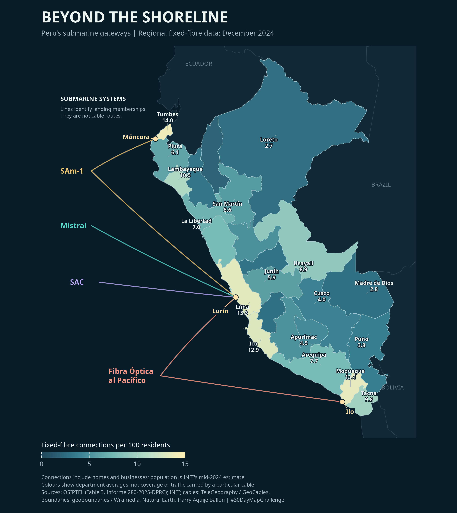

# Beyond the Shoreline

**Peru's submarine gateways and fixed-fibre connectivity.**

A map for **Day 24 — Network** of the **2026 #30DayMapChallenge**, made in R by [Harry Aquije Ballon](https://harryaquijeballon.com/).



## What the map shows

The map combines selected submarine cable systems and their Peruvian landing localities with fixed-fibre connections per 100 residents across Peru's departments.

The regional layer uses December 2024 connection counts from OSIPTEL and mid-2024 population estimates from INEI. The national rate calculated from these inputs is **8.77 fixed-fibre connections per 100 residents**.

This is subscription density. A connection can serve several people, and the totals include homes and businesses. It is not a percentage of people connected, a coverage measure, or an exclusively FTTH measure.

The offshore lines link system labels to landing localities. **They show system memberships, not surveyed cable routes, direct segment adjacency or traffic flows.** No terrestrial transport network is drawn, and the regional layer does not attribute subscribers to particular cables.

## Reproduce the map

1. Download this repository using **Code → Download ZIP**, then extract it.
2. Open **peru-internet-network.Rproj** in RStudio.
3. Install the packages once:

```r
install.packages(c("sf", "dplyr", "readr", "ggplot2", "ggrepel", "scales", "ragg"))
```

4. Open **1_analysis/24_network_v2.R** and run the complete script, or run:

```r
source("1_analysis/24_network_v2.R")
```

All map inputs are included. After package installation, the script does not need to download data. It validates the 25 departmental joins and national totals before exporting a 300 dpi PNG.

From a terminal with R installed, the equivalent command from the repository root is:

```sh
Rscript 1_analysis/24_network_v2.R
```

## Project structure

| Path | Contents |
| --- | --- |
| `2_script/24_network_v2.R` | Complete mapping script |
| `1_analysis/00_raw_data/24_network/peru_submarine_geodata_stage/` | Input tables, boundaries and provenance metadata |
| `1_analysis/01_clean_data/24_network/` | Calculated departmental indicators, created when the script runs |
| `1_analysis/02_intermediate_data/24_network/` | Spatial and plot objects, created when the script runs |
| `1_analysis/03_output/24_network/peru_fibre_network_v2.png` | Final map |

Generated clean and intermediate files are excluded from version control. The final map is included.

## Sources and interpretation

See [DATA_SOURCES.md](DATA_SOURCES.md) for source links, dates, boundary processing and data limitations. The source snapshot is historical; this is not a live cable inventory or a 2026 connectivity estimate.

The national rate is `100 * sum(fibre_connections) / sum(population)`. It is equivalent to a population-weighted average of departmental rates.

## Code and data rights

The original R source code is available under the [MIT License](LICENSE). This code license does not apply to third-party datasets or the map artwork. Third-party data retain their providers' terms and attribution requirements; see [DATA_SOURCES.md](DATA_SOURCES.md).
