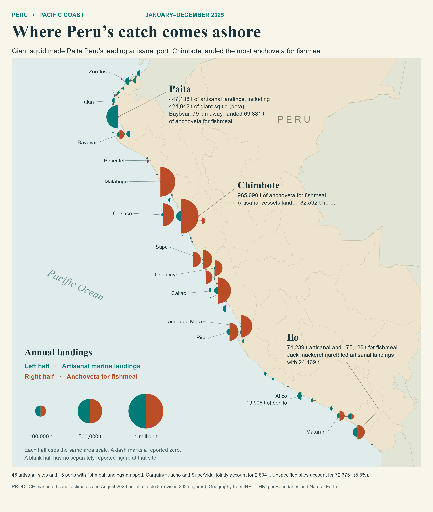

# Where Peru’s catch comes ashore

Day 26 · Water · 2026 #30DayMapChallenge  
Map by Harry Aquije Ballon, made in R.



In 2025, Paita led Peru’s marine artisanal landings with an estimated 447,138 tonnes. Giant squid (*pota*) accounted for 424,042 tonnes of that total. Farther south, Chimbote led the country in anchoveta landed for fishmeal, with 985,690 tonnes.

Each port symbol compares two January–December totals. The teal half shows marine artisanal landings across species. The orange half shows anchoveta landed for fishmeal. Both halves use the same area scale. The map covers 48 localities. [Data sources and coverage](DATA_SOURCES.md)

## Run the map

1. Download the repository with **Code → Download ZIP**, extract it, and open `26-water/30daymapchallenge.Rproj` in RStudio.
2. Install the R packages once.

   ```r
   install.packages(c("readxl", "dplyr", "sf", "units", "ggplot2", "patchwork", "ragg"))
   ```

3. Open [the map script](2_script/26/26_water_landings_2025.R). In section 1, replace my Windows path on the `project_root <-` line with `project_root <- getwd()` and save. With the RStudio project open, `getwd()` points to the extracted `26-water` folder. You can also enter that folder’s full path directly.
4. Run the sections in order or run the following in the RStudio console.

   ```r
   source("2_script/26/26_water_landings_2025.R", encoding = "UTF-8")
   ```

The map script runs [the preparation script](2_script/26/26_water_check_landings_2025.R), which reads the two PRODUCE workbooks. After section 3, use `View(port_values)` to inspect the tonnes, leading species and nearest fishmeal port for each locality. Section 8 saves the [300 dpi PNG](1_analysis/03_output/26_water/26_water_peru_landings_2025.png). All five input files are included.
