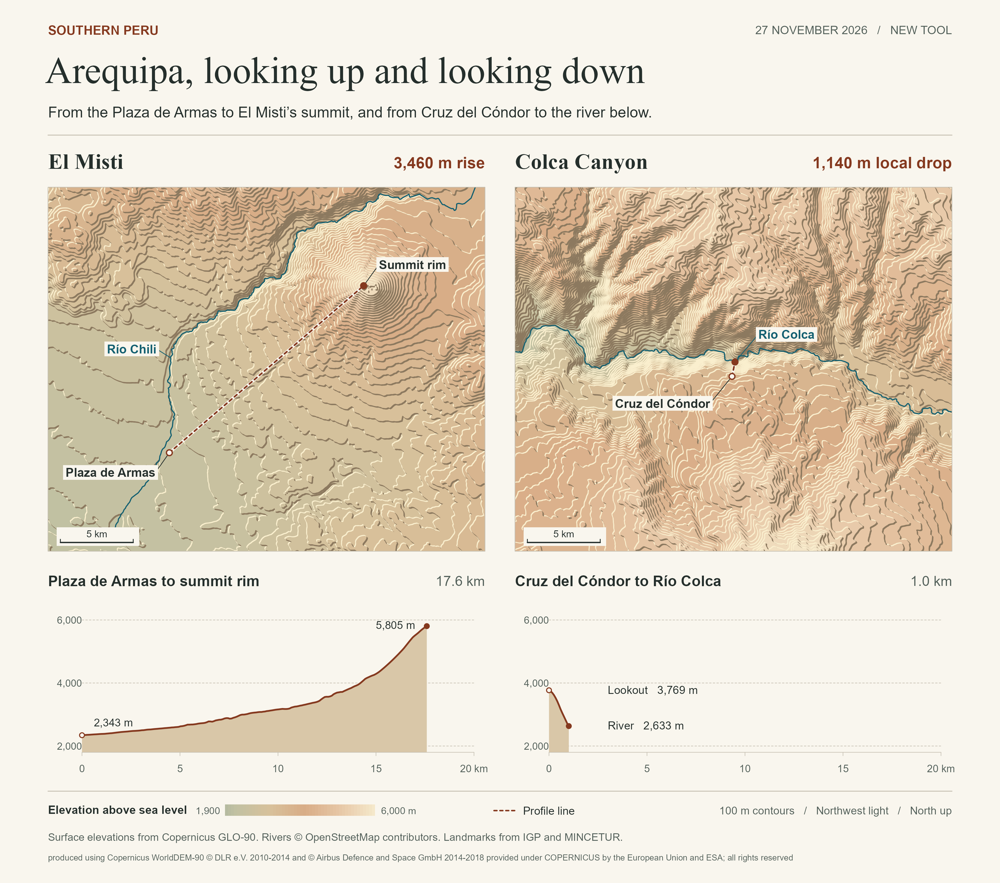

# Arequipa, looking up and looking down

Day 27 · New tool · 2026 #30DayMapChallenge  
Map by Harry Aquije Ballon, made in R.



For today’s challenge I tried the `tanaka` R package on two places in my home region of Arequipa. The light and dark edges of the contours pick out the shape of El Misti’s crater rim and the steep walls above the Río Colca.

Both maps cover 30 × 25 km, with a contour every 100 metres of elevation. The profiles below them follow the marked lines and share the same horizontal and vertical scales. The right-hand profile measures the local drop from the Cruz del Cóndor lookout to the nearest point on the river. [Data and measurement notes](DATA_SOURCES.md) · [Four endpoint elevations](1_analysis/01_clean_data/27_new_tool/transect_endpoints.csv) · [Tanaka package examples](https://cran.r-project.org/web/packages/tanaka/readme/README.html)

## Run the map

1. Download the challenge repository using **Code → Download ZIP**, extract it, and open `27-new-tool/27-new-tool.Rproj` in RStudio.
2. Install the packages once.

   ```r
   install.packages(c("terra", "sf", "jsonlite", "tanaka", "ragg"))
   ```

3. Open the [commented R script](2_script/27/27_arequipa_relief.R) and run sections 1–6 in order, or use the RStudio console.

   ```r
   source("2_script/27/27_arequipa_relief.R", encoding = "UTF-8")
   ```

The five geographic input files are included. Section 3 writes the [endpoint elevations](1_analysis/01_clean_data/27_new_tool/transect_endpoints.csv) and [profile samples](1_analysis/02_intermediate_data/27_new_tool/elevation_profiles.csv). Section 6 saves the [300 dpi PNG](1_analysis/03_output/27_new_tool/27_arequipa_looking_up_and_down_v1.png). Run `draw_figure()` to view it in RStudio.
